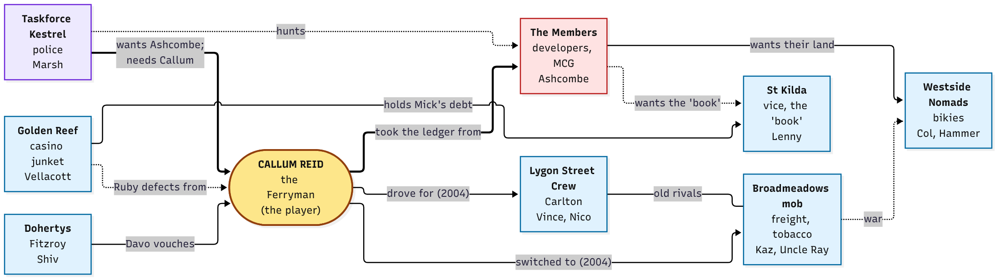
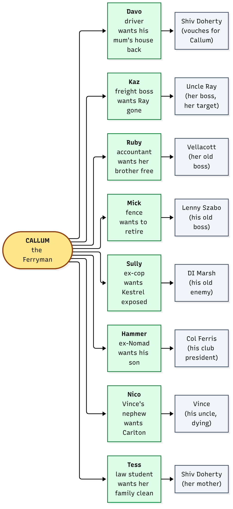

# The Ferryman: the story in one page

**Setting:** Melbourne, now. 2004 is a memory, told by the man who lived it.

**One line:** A quiet, calculating man comes back to Melbourne by boat, twenty-two years after he left the same way,
and builds an empire without firing a shot himself.

---

## 1. The synopsis

### The frame (now, 2026)

Callum Reid, "the Ferryman", steps off a boat on Harbour Esplanade in Docklands at night. He is about 47. He left from
this exact spot in 2004 and took something with him: a ledger. Nobody knows where he has been. Davo, his old driver, is
waiting with a car. A grey Comodo, two police up, has been parked on the esplanade since Tuesday.

Vince Lombardo, the old boss of Carlton, is dying and has sent for him. On the drive in, Callum remembers how he got
his name.

### The memory (2004)

*Played as seven jobs, told in Callum's voice. One thread runs through all of them: Vince's black book.*

Callum is back from three years abroad. He is a good driver and he keeps his mouth shut. A war has run for six years
between two crews:

- **The Lygon Street Crew** (Carlton, Fitzroy): old families, old rules. Vince runs it, and Vince keeps the book.
- **The Broadmeadows firm**: freight, tobacco, chop shops. Kaz Whitlock runs its Melbourne end for her uncle Ray.
- **The Westside Nomads**: a bikie club in the middle, buying whatever is for sale.
- **Taskforce Kestrel**: the police, closing in on all of them.

Somebody is selling pages out of the book. Callum works for Vince first, then for Kaz, and each job pulls the same thread:

1. **Laneway Hustle** (Vince): get Davo and what is left of the book to the lock-up in Carlton before the firm does.
2. **Word on the Street** (Vince): who is selling pages? Fitzroy talks, and it points to a pub on Smith Street.
3. **The Informant** (Kaz): at the pub, Kaz makes her offer: Vince has a man who records everything and sings to Kestrel.
   Get the tapes. "Vince never paid you what you're worth. I will." Callum switches sides: "I go where the money is."
4. **Westside Bikies** (Kaz): the tapes show the Nomads bought the pages. They are on a boat in Docklands.
5. **Tobacco Wars** (Kaz): the rest of the book is in the Nomads' warehouse at South Wharf. Burn it, take the pages.
6. **Short Black** (Kaz and Mick): a sit-down in St Kilda. Mick has the last pages and a photograph of a developer shaking
   hands with a Kestrel detective. "Whoever holds that photograph owns this town."
7. **Harbour Run** (Kaz): Kestrel raids the Brighton house. Both crews know the book is gone, and who took it.

What nobody saw: he was never working for either side. He was working for the **ledger**, a book that records who paid
whom: police, a developer, a minister's office. Both gangs' money ran through it. He leaves by boat with it, and the last
thing he does in 2004 is vanish. Who tipped Kestrel off has never been said. He lets people believe what they like.

### Act I, Low Tide (2026)

The boat arrives. Davo is grey and sober. Callum loses the grey Comodo, takes over a failing laneway bar, the **Quiet
Room**, and meets Vince for Sunday lunch. Vince wants Carlton to go to someone who "sits still". Callum picks up a
defector from the casino junket, Ruby, and finds a Kaz who has gone legitimate and is still dangerous. Kestrel raids
the bar. Someone told them which floorboard to look under. The ledger gets out. Someone on his side is the leak.

### Act II, The Board

He stops doing the jobs himself. He appoints lieutenants and gives each a territory, and he plays the families against
each other: Fitzroy's Dohertys, the Members at the MCG, a junket in Southbank, the Nomads, the last vice king of St
Kilda. Every faction meets for a truce at Albert Park, neutral ground. Someone is shot there. The truce breaks and the
war starts again.

### Act III, The Crossing

Kestrel offers him a deal. The war hits three territories at once. He breaks into the developer's site office for the
bribe ledger and confronts the traitor at the Shrine at dawn. In the finale three lieutenants carry out his plan while
he sits across a table from the developer in the shadow of Parliament.

**Three endings:**
- **The Crown:** he joins the Members. The empire becomes the Establishment.
- **The Badge:** he hands the developer and the ledger to Kestrel and owes them for ever.
- **The Ferry:** he burns it down, gives each territory to its loyal lieutenant and leaves by water, the way he came.

**What's playable now:** Low Tide, then the seven 2004 jobs. The rest of Act I, and Acts II and III, are designed but not
built. The game also has a wanted level and police.

---

## 2. The characters

Ages are in 2026, with 2004 in brackets.

### The player

**Callum Reid, "the Ferryman"** (47; 25 in 2004). Quiet, patient, never raises his voice, always the last to sit down.
He repays debts exactly and remembers slights for decades. He doesn't like violence and uses it as a tool.
- *Then:* a driver who had been abroad three years. He played both gangs.
- *Now:* wants to own the thing that owns Melbourne, the place where money, land and permits meet.
- *The mystery:* where he has been, and who tipped Kestrel off. He corrects nobody's story.

### The old Carlton family

**Vince Lombardo** (66; 44). Boss of the Lygon Street Crew. In a cardigan, on oxygen, he runs it from a long lunch table
in Argyle Square.
- *Then:* gave Callum small jobs and no trust.
- *Now:* dying. Wants an orderly exit and someone who "sits still".

**Nico Lombardo** (34; 12). Vince's nephew. Ambitious.
- *Wants:* Carlton, with or without his uncle's blessing. Calls Callum the man who "ran for Kaz".

**Nonna Pina.** Vince's sister. Runs the pasticceria and the books.

**Sal Ferrante** (50). Vince's enforcer.

### The Broadmeadows firm

**Karen "Kaz" Whitlock** (49; 27). Ruthless, funny, ambitious.
- *Then:* offered Callum the respect Vince didn't. Her uncle Ray sat above her.
- *Now:* runs a freight company at the yards.
- *Wants:* to overthrow Uncle Ray and go legitimate.

**Uncle Ray.** Off-map in Broadmeadows. Appears once, at the truce.

**Jonno Pike.** Her yard boss. **Leila Haddad.** Her fixer at the market.

### Callum's people

**Davo Kearney** (50; 28). Vince's driver, then Callum's. Sober now and still driving.
- *Then:* the man you picked up in the first job.
- *Now:* wants to buy back his late mum's Collingwood house and keep his daughter Chloe out of it.
- *Why he helps:* in 2004 Callum covered for a debt Davo owed.

**Mick Fallon** (about 58). A fence, now a pawnbroker in St Kilda. Moves watches, phones, "whatever falls off a
truck".
- *Wants:* to clear a gambling debt to the casino junket and retire to Lorne.

**Ruby Achterberg** (about 38). A junket accountant who defects. Brilliant with money.
- *Wants:* to free her brother Joost from a charge her old boss arranged.

**Gus Pappas.** Owner of the Quiet Room. Broke. His father ran it for thirty years.

**Brendan "Sully" Sullivan** (about 55). A detective Kestrel sacked in 2005.
- *Wants:* to prove Kestrel buried evidence in 2004.

### The rivals

**Col Ferris** (58). President of the Westside Nomads. Wants their land sold at the best price.

**Hamish "Hammer" Kowalczyk** (41). His sergeant-at-arms, who wants out alive and wants custody of his son.

**Shiv Doherty** (55). Publican of the Gipps Arms in Collingwood. Runs Fitzroy by grudge and loyalty.
- **Tess Doherty** (24): her daughter, a law student, who wants the family clean.
- **Fergal Doherty** (44): her unreliable brother, dealing out of the towers.

**Terry "Doors" Maguire** (52). A former boxer. Runs the doors on King Street.

**Marcus Vellacott** (47). A Gold Coast junket operator in a Southbank suite, counting cash by machine.

**Lenny Szabo** (74). The last of St Kilda's vice kings. Holds a "book" of photographs on half the city.

### The establishment

**Gerald Ashcombe** (63). A developer and the head of "the Members" (MCG, boards, planning panels). Wants the Fishermans
Bend rezoning and nobody looking. He is the old money behind the 2004 ledger.
- **Philippa Crane:** his chief of staff to a minister.

### The police

**Detective Inspector Helen Marsh** (51). Kestrel's head. Patient and under-resourced. Orders a lemonade.
- *Wants:* to finish what Kestrel failed to do in 2004. Offers Callum a deal.

---

## 3. How they relate

### The big picture: who stands where

A thick line is the spine of the story. A dotted line is a tension that can break either way.

### Callum's own circle: who each person is tied to

Each person on the left is a lieutenant or helper. The box on the right is the outsider who pulls on them. Their
loyalty to Callum is tested by that pull.

**The spine of the story, in three arrows:**
1. Callum took the **ledger** from **Ashcombe's** world in 2004.
2. **Marsh** wants Ashcombe and needs Callum to get him.
3. Callum's own people are the leak, and his choice of lieutenants decides who it is.

---

## 4. The order of play

| Part | What it is | State |
|---|---|---|
| Frame | arrival by boat; Davo; the grey Comodo | Low Tide, built |
| The memory | seven 2004 jobs on one thread, told by Callum | built |
| Act I | the Quiet Room, Sunday lunch, the leak, the raid | Low Tide built; five missions to go |
| Act II | lieutenants, territories, the truce that breaks | designed |
| Act III | the war, the traitor, three endings | designed |

The full mission list, locations and mechanics are in `EMPIRE_DESIGN.md` and `MILESTONES.md`.
